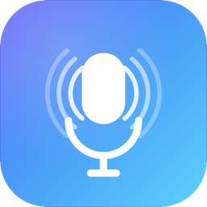

<div align="center">



# WhisperLocal

**Press a key. Speak. The transcript appears at your cursor — in any app.**

[](LICENSE)
[](#requirements)
[](#requirements)
[](https://github.com/WEBER-marcoscheffler/WhisperLocal/releases/latest)

Local-first speech-to-text for macOS. **No cloud. No account. No telemetry.**

</div>

---

## Why WhisperLocal?

System dictation on macOS sends your voice to Apple's servers. Most local STT tools require a terminal and Python skills.

WhisperLocal is the alternative: **a tiny menu bar app, fully offline, that just works.** Hold a hotkey or tap it, speak, and your words land at the cursor — in Terminal, VS Code, Slack, Notes, the address bar of your browser, anywhere.

## Highlights

- 🎙 **System-wide dictation** — works in every text field on your Mac
- ⌨️ **Tap to start, stay silent to stop** — or push-to-talk if you prefer
- 🇩🇪🇬🇧 **German + English** with auto-detection
- 🧠 **Apple Intelligence cleanup** removes "ähm", fixes punctuation (optional)
- 🔒 **100 % local** — nothing ever leaves your Mac
- ⚡️ **Sub-second latency** on Apple Silicon thanks to CoreML
- 🎨 **Looks like a Mac app should** — menu bar icon, floating overlay, native settings

## Install

### Option A — Download (recommended)

1. Grab the latest **WhisperLocal-x.y.z.zip** from [Releases](https://github.com/WEBER-marcoscheffler/WhisperLocal/releases/latest).
2. Unzip and drag `WhisperLocal.app` into `/Applications`.
3. Open it. Grant **Microphone**, **Accessibility**, and **Input Monitoring** when prompted. Relaunch once after granting.

The release is signed with a Developer ID certificate and notarized by Apple, so Gatekeeper opens it without warnings.

### Option B — Build from source

```bash
git clone https://github.com/WEBER-marcoscheffler/WhisperLocal.git
cd WhisperLocal
./Scripts/create-dev-cert.sh    # one-time
./Scripts/install.sh
```

See [docs/DEVELOPMENT.md](docs/DEVELOPMENT.md) for the full guide.

## How to use

1. Press and hold (or tap) **⌥⌘** — the default hotkey
2. Speak
3. Stop by tapping again, or just stay silent for 2 seconds

That's it. The cleaned transcript is pasted wherever your cursor is.

Every setting — hotkey, language, microphone, post-processing, autostart — lives in the menu bar icon's **Settings…** window.

## Privacy

- Whisper runs locally via [WhisperKit](https://github.com/argmaxinc/argmax-oss-swift) (CoreML)
- LLM cleanup uses Apple's on-device [FoundationModels](https://developer.apple.com/documentation/foundationmodels)
- The Whisper model is downloaded once from HuggingFace; everything else stays on your Mac
- No analytics, no crash reporting, no third-party SDKs
- [Read the privacy section in the docs](docs/DEVELOPMENT.md#privacy) for details

## Requirements

- macOS 15 (Sequoia) or later — macOS 26 (Tahoe) recommended
- Apple Silicon (M1 or newer)
- ~600 MB free disk for the Whisper model

## More

- 📖 **[Developer & maintainer docs](docs/DEVELOPMENT.md)** — architecture, all settings, troubleshooting, release process
- 🐛 **[Issues](https://github.com/WEBER-marcoscheffler/WhisperLocal/issues)** — bug reports & ideas welcome
- 📄 **[License](LICENSE)** — MIT

---

<div align="center">

Built with [WhisperKit](https://github.com/argmaxinc/argmax-oss-swift), [OpenAI Whisper](https://github.com/openai/whisper), Apple FoundationModels, and Swift 6.

</div>
